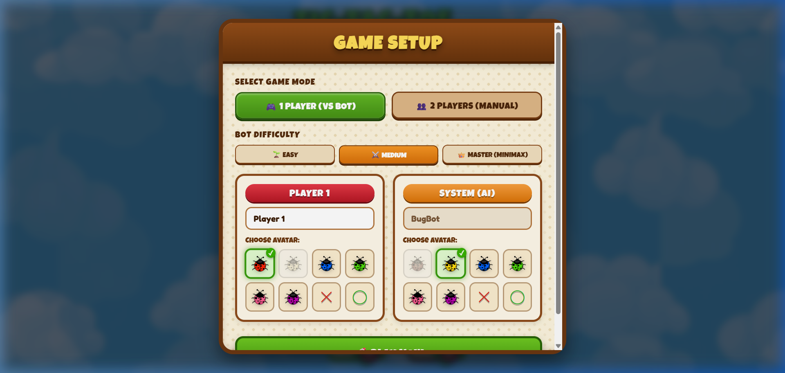
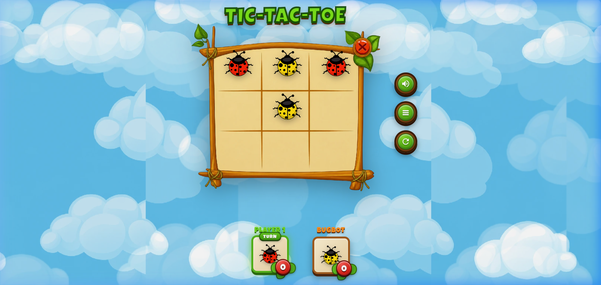
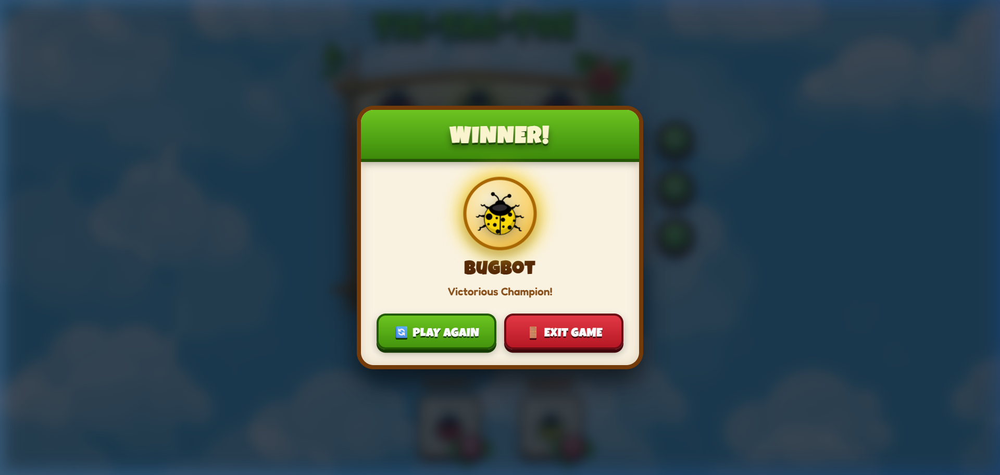

# 🐞 Tic-Tac-Toe: Bug Battle Adventure

[](https://bugbot-pearl.vercel.app)

> **🌐 Play Live Online:** [https://bugbot-pearl.vercel.app](https://bugbot-pearl.vercel.app)

A whimsical, cartoon-styled desktop and mobile Tic-Tac-Toe game crafted with React 18, Vite, and Vanilla CSS. Built faithfully to replicate the wooden-jungle board aesthetics of the reference artwork with animated drifting clouds, custom wooden cursors, cute ladybug avatars, intelligent AI (including unbeatable Minimax), calm ambient music, organic sound effects, and local state caching with TTL auto-expiry.

---

## 📸 Screenshots Showcase

| Game Setup & Avatar Selection | Active Wooden Board Match | Winner Celebration Fanfare |
| :---: | :---: | :---: |
|  |  |  |

---

## ✨ Features & Polish

### 🎨 Visuals & Aesthetics (Faithful to Reference Artwork)
- **Wooden Puzzle Frame**: Calibrated grid overlay onto `public/images/Puzzle Board.webp` complete with ropes, corner vines, and leaf accents.
- **Top 3D Jungle Banner**: Chunky, playful `TIC-TAC-TOE` banner rendered with custom multi-layer drop shadows and cartoon typography.
- **Parallax Cloud Sky**: Smooth, continuous horizontal drifting background powered by CSS keyframes and `public/images/CartoonSky.webp`.
- **Custom Wooden Cursor**: 3D beveled wooden pointer arrow matching the reference cursor.
- **Scorecards with Leaf Badges**: Wooden player frame with active turn glow, bouncing animations, and red circular score badges backed by green leaves.

### 🎮 Game Modes & Artificial Intelligence
- **1 Player (vs System / BugBot)**:
  - **Easy**: Casual, relaxed moves with high randomness.
  - **Medium**: Tactically snatches instant wins and blocks human winning lines.
  - **Master (Minimax)**: Recursively evaluates all future move states to deliver an unbeatable challenge.
- **2 Players (Pass & Play)**: Manual turn-based battle on the same device.

### 🐛 Extensible Avatar System
- **Ladybug Collection**: Ruby Red (Player 1 default), Golden Yellow (Player 2 default), Sapphire Blue, Emerald Green, Rose Pink, and Amethyst Purple.
- **Classic Symbols**: Jungle X and Jungle O.
- **Duplicate Prevention**: Mutual exclusion logic prevents both players from choosing the identical avatar simultaneously.

### 🔊 Audio Engine (Calm Vibe & Zero-Latency SFX)
- **Calm BGM**: Ambient background music (`public/audio/bg-music.mp3`) defaulted to a soothing low volume (~15%).
- **Synthesized Web Audio SFX**: Zero network delay, pure programmatic audio oscillators:
  - *Place Bug*: Bouncy wood-block chirp.
  - *Button Tap*: Light wooden click.
  - *Selection*: High-pitch pleasant bubble blip.
  - *Victory*: Uplifting 4-note major arpeggio with celebratory confetti.
  - *Draw*: Comedic sliding wobble.
- **Controls**: In-game volume sliders and mute toggles for both BGM and SFX.

### 💾 Local Caching with TTL Expiration
- **Reload Resilience**: Ongoing games, player scores, turns, and configurations are safely preserved in `localStorage`.
- **30-Minute Auto-Expiry**: If the player leaves and returns after > 30 minutes of inactivity, the session automatically resets.
- **Manual Exit Wipe**: Clicking the top-right red **X** button or exiting via settings immediately purges cached data.

---

## 🧠 Game Logic & AI Architecture

The game's deterministic engine is located in [`src/utils/gameLogic.js`](src/utils/gameLogic.js):

### 1. Board Representation & Win Detection
The 3×3 grid is represented as a 1D array of 9 elements:
```
[ 0, 1, 2 ]
[ 3, 4, 5 ]
[ 6, 7, 8 ]
```
There are exactly 8 winning combinations:
```javascript
export const WINNING_COMBINATIONS = [
  // Rows
  [0, 1, 2], [3, 4, 5], [6, 7, 8],
  // Columns
  [0, 3, 6], [1, 4, 7], [2, 5, 8],
  // Diagonals
  [0, 4, 8], [2, 4, 6]
];
```
`checkWinner(board)` iterates through these 8 combinations:
- Returns `{ winner: 'p1' | 'p2', line: [a, b, c], isDraw: false }` if three cells match.
- Returns `{ winner: null, line: null, isDraw: true }` if all 9 cells are filled with no winner.
- Returns `{ winner: null, line: null, isDraw: false }` if the match is still active.

### 2. Minimax AI Algorithm (Master Difficulty)
In `master` mode, the AI uses depth-discounted recursive Minimax:
```
Score(state, depth) =
  + (10 - depth)   if AI wins (prefers quick wins)
  - (10 - depth)   if Human wins (delays loss)
  0                if Draw
```
1. Base cases: If terminal state (win, loss, draw), return score.
2. Recursive step:
   - For each open square, simulate placing the mark.
   - If AI turn: maximize score over all possible human replies.
   - If Human turn: minimize score over all possible AI replies.
   - Backtrack by restoring cell to `null`.
3. The optimal move index with the highest evaluation score is chosen.

---

## ➕ How to Easily Add New Avatars

The avatar system is completely decoupled and configured through [`src/config/avatars.js`](src/config/avatars.js).

To add a new avatar to the game:
1. Place your image file in `public/images/` (e.g. `public/images/bug_orange.webp` or SVG).
2. Open [`src/config/avatars.js`](src/config/avatars.js) and append an entry to the `AVATARS` array:

```javascript
export const AVATARS = [
  // Existing avatars...
  
  // 👉 Add your new avatar here:
  {
    id: 'bug_orange',
    name: 'Sunset Ladybug',
    type: 'image',
    src: '/images/bug_orange.webp',
    accentColor: '#f77f00'
  },
  
  // 👉 Or add a custom symbol:
  {
    id: 'star_symbol',
    name: 'Golden Star',
    type: 'symbol',
    symbol: '★',
    color: '#ffb703',
    accentColor: '#ffb703'
  }
];
```
The game will automatically render your new avatar in the setup modal, board cells, score cards, and winner modals with full animation support!

---

## 🗄️ Cache TTL & State Storage Policy

The storage manager in [`src/services/storageService.js`](src/services/storageService.js) manages session lifecycle:
- **Storage Key**: `TICTACTOE_BUG_GAME_STATE_V1`
- **TTL Limit**: 30 minutes (`30 * 60 * 1000` ms)
- **Activity Timestamp**: Every move or state change records `lastActive: Date.now()`.
- **Expiration Policy**:
  ```javascript
  if (!data.lastActive || Date.now() - data.lastActive > CACHE_TTL_MS) {
    clearGameState(); // Purges expired session
    return null;
  }
  ```
- **Manual Purge**: When a player clicks the red **X** button on the wooden frame or selects "Change Mode & Avatars", the session is instantly erased to start fresh.

---

## 🚀 Getting Started

### Prerequisites
- Node.js (v18 or newer)
- `pnpm` (or `npm` / `yarn`)

### Installation & Run

1. Clone repository:
   ```bash
   git clone https://github.com/Amiz001/Tic-Tac-Toe-Game.git
   cd Tic-Tac-Toe-Game
   ```

2. Install dependencies:
   ```bash
   pnpm install
   ```

3. Run development server:
   ```bash
   pnpm run dev
   ```
   Open `http://localhost:5173/` in your browser.

4. Build production bundle:
   ```bash
   pnpm run build
   ```

---

## 📄 License
MIT License. Created with love for cartoon game aesthetics.
